# References: LP Peter Parker

## 1. Objetivo

As referências abaixo orientam as decisões de design e de animação da LP do
Peter Parker (Atividade 3, Vibecoding). Entram aqui só **referências**
(sites e componentes de outros autores) que realmente inspiraram alguma parte
do projeto. O código foi escrito do zero: nenhum componente foi copiado, só a
ideia de cada um foi aproveitada. As imagens do próprio projeto não fazem
parte deste documento.

## 2. Referência 01: Lando Norris

### Fonte
https://landonorris.com/ (captura de tela e gravação de tela feitas pelo autor)

### Imagem

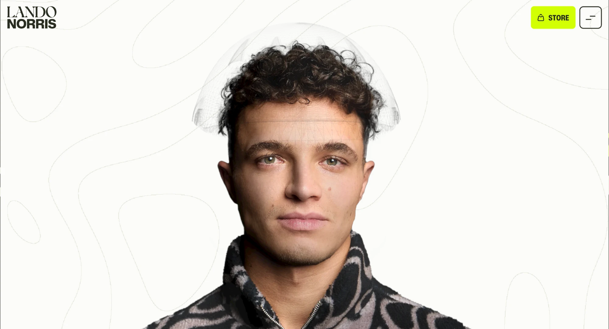

Gravação de tela do site: [referencia-01-lando-norris-gravacao.mp4](./imagens/referencia-01-lando-norris-gravacao.mp4)

### O que observamos?
O site abre com o retrato do piloto centralizado, em fundo claro com linhas
topográficas muito discretas. O menu some para os cantos: o logo de um lado e,
do outro, o botão de destaque e o botão de menu. Ao passar o mouse sobre o
rosto, uma camada diferente aparece por cima da foto só onde o mouse passa
(no original, o capacete e os patrocinadores), em vez de a tela inteira mudar.

### O que vamos aproveitar?
O retrato como protagonista da primeira tela, o menu nos cantos e, principalmente,
a ideia de a interação acontecer **no próprio rosto**, revelando outra versão da
pessoa só onde o mouse passa.

### Como será adaptado?
A foto do Peter ocupa a tela, e o mouse funciona como um pincel: onde ele passa,
o rosto vira a máscara do Homem-Aranha, o corpo vira o traje e o fundo fica
vermelho (`src/components/PaintCanvas.jsx`). O mesmo pincel troca "PETER PARKER"
por "HOMEM ARANHA" no logo, e o header segue a mesma organização nos cantos
(`src/components/HomeUI.jsx`).

## 3. Referência 02: 21st.dev (Scroll-Locked Video Hero)

### Fonte
https://21st.dev/community/components?preview=%2F%40gughigug%2Fcomponents%2Fscroll-locked-video-hero
Componente de gughigug no 21st.dev.

### Imagem

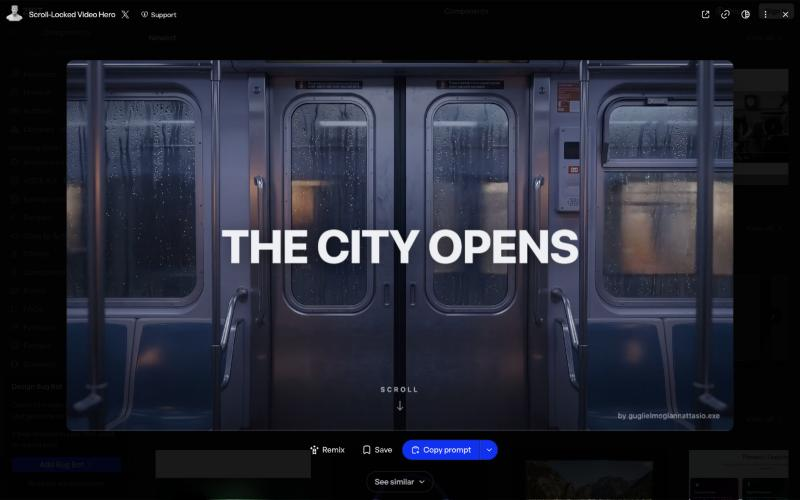
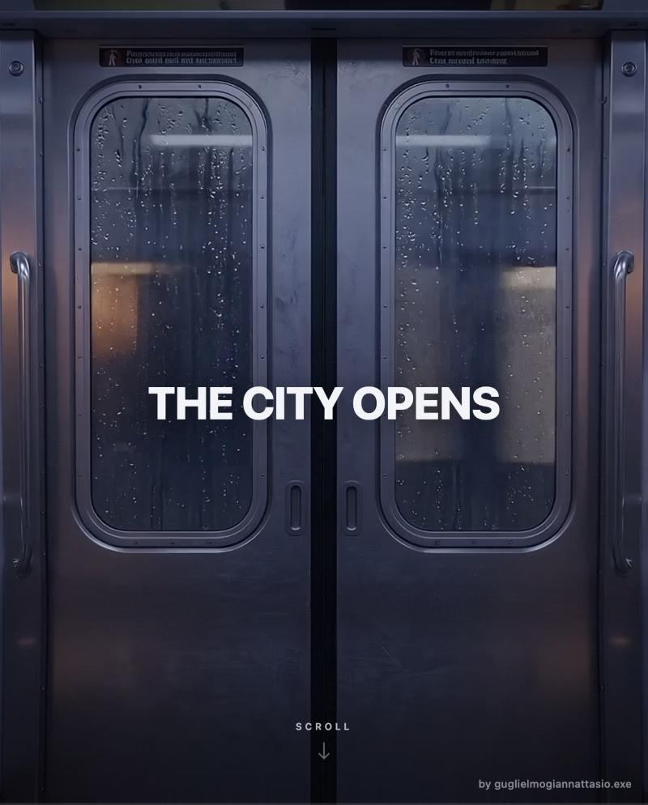
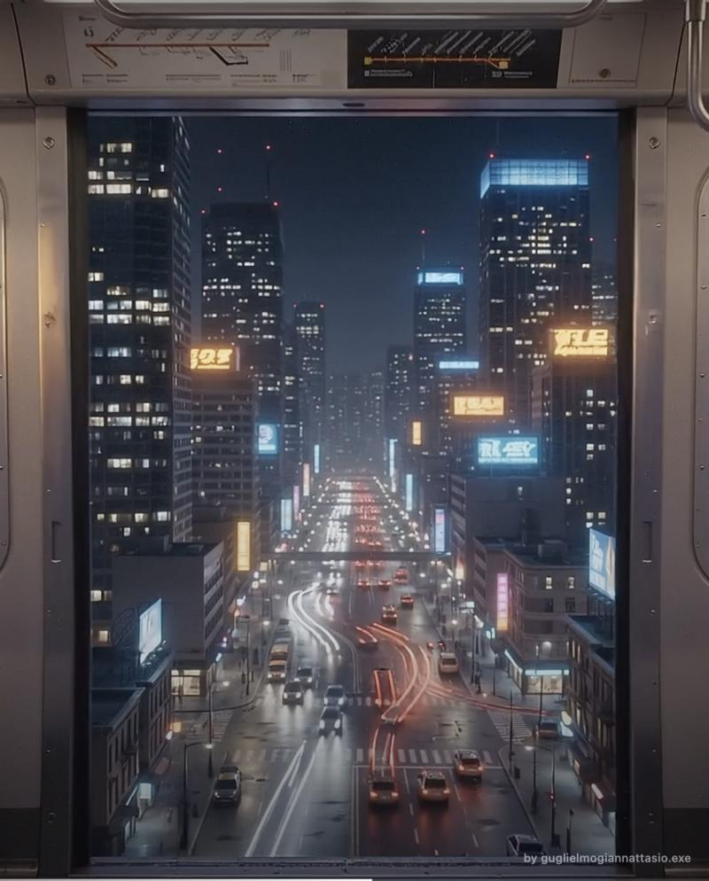
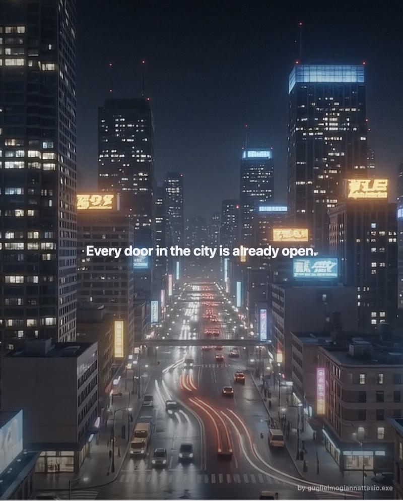

### O que observamos?
A página **para de rolar** e a rolagem do mouse passa a controlar um vídeo, para
frente e para trás, com suavização. Quando o vídeo chega ao fim, a página destrava
e segue normalmente (e trava de novo se a pessoa voltar). O título se desfaz em
desfoque conforme a rolagem avança, e uma barra fina embaixo mostra o progresso.

### O que vamos aproveitar?
A mecânica de **prender a rolagem e transformá-la em progresso de uma cena**,
além do título que se desfaz em desfoque e da barra de progresso.

### Como será adaptado?
O componente original usa TypeScript e Tailwind e controla um vídeo. Na LP o
comportamento foi reescrito em JavaScript puro (`src/lib/useScrubLock.js`) e
controla uma cena própria na seção Poderes (`src/components/PowersSection.jsx`):
despertador, olho que abre, mergulho na cidade, disparo da teia e montagem das
folhas do caderno. Também foi preciso travar a página de verdade (`overflow: hidden`),
porque no Chrome do Mac o gesto do trackpad não pode ser cancelado por JavaScript.

## 4. Referência 03: 21st.dev (componentes de relógio)

### Fonte
https://21st.dev/community/components/s/clock
Categoria "Clock" do 21st.dev.
Componentes observados: **Flip Clock** (satoriui) e **Sliding Number** (Julien Thibeaut).

### Imagem

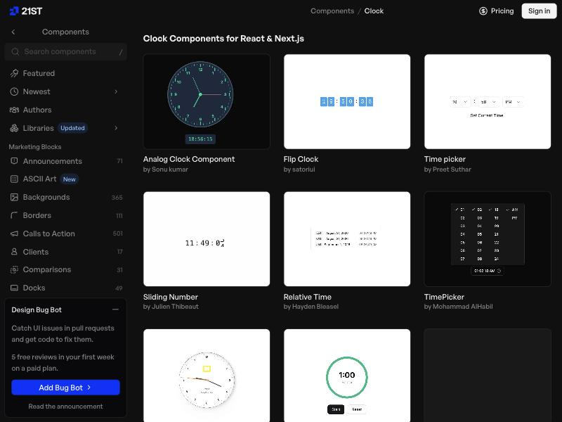

### O que observamos?
Os relógios digitais da categoria mostram a hora em dígitos grandes e separados:
no Flip Clock cada dígito fica num bloco próprio (horas, minutos e segundos
separados por dois pontos), e no Sliding Number os dígitos se trocam com um
deslize quando o valor muda.

### O que vamos aproveitar?
A ideia de tratar a hora como um **elemento visual da tela**, com dígitos
grandes e dois pontos entre os grupos, em vez de texto comum.

### Como será adaptado?
Na abertura da seção Poderes, o relógio é um **despertador de LED** de sete
segmentos desenhado em SVG (`src/components/Segments.jsx`), com os segmentos
apagados levemente visíveis e os dois pontos piscando. O mesmo componente é
reaproveitado no visor LCD do rádio-scanner do Encerramento.

## 5. Referência 04: 21st.dev (componentes de cursor)

### Fonte
https://21st.dev/community/components/s/cursor
Categoria "Cursor" do 21st.dev.
Componentes observados: **Inverted Cursor** (Arunachalam), **Custom Cursor** (lukacho/ui)
e **Fluid Magnetic Cursor** (Hossain Jahed).

### Imagem

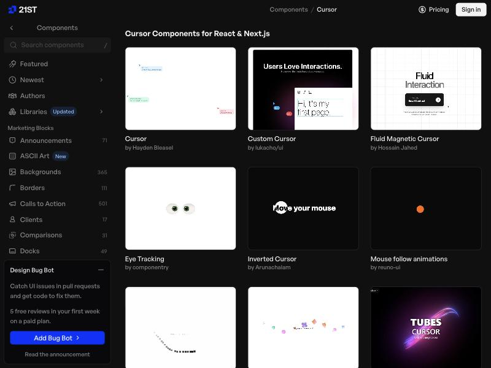

### O que observamos?
O cursor deixa de ser a seta padrão do sistema e vira um elemento da interface:
um círculo que acompanha o mouse (no Inverted Cursor, ele inverte as cores do
texto por onde passa, na frase "Move your mouse") e que reage ao que está embaixo.

### O que vamos aproveitar?
O cursor como parte do design, com um círculo que segue o mouse com um pequeno
atraso e muda de tamanho conforme o que está embaixo.

### Como será adaptado?
`src/components/Cursor.jsx` esconde o cursor do sistema e desenha um ponto mais
um anel que segue o mouse com suavização. Na primeira tela o anel tem o tamanho
do pincel (mostra onde a máscara vai aparecer), cresce sobre links e botões e
fica branco durante a intro.

## 6. Referência 05: 21st.dev (Stacked Card)

### Fonte
https://21st.dev/community/components/s/stacked-card
Categoria "Stacked Card" do 21st.dev.
Componentes observados: **Notification Stack** (Saurabh) e **Wallet Card** (Edu Calvo).

### Imagem

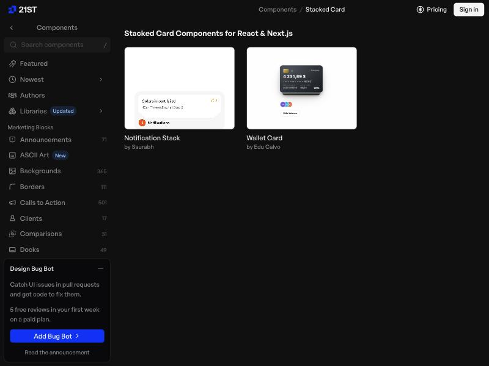

### O que observamos?
Os cartões ficam empilhados uns sobre os outros, com o de cima inteiro e os de
baixo aparecendo só nas bordas, um pouco menores e deslocados, o que dá a
sensação de profundidade.

### O que vamos aproveitar?
A pilha como forma de mostrar vários itens no mesmo espaço, com o item atual
em destaque e os anteriores recuando.

### Como será adaptado?
Na seção Queens à noite (`src/components/QueensSection.jsx`), as capas da
"Gazeta de Queens" caem uma sobre a outra de segunda a sábado. A capa atual fica
inteira e inclina seguindo o mouse; as anteriores escurecem, diminuem e saem um
pouco do lugar, formando a pilha.

## 7. Referência 06: Daily Bugle (Marvel)

### Fonte
https://www.marvel.com/teams-and-groups/daily-bugle (site oficial da Marvel)

### Imagem

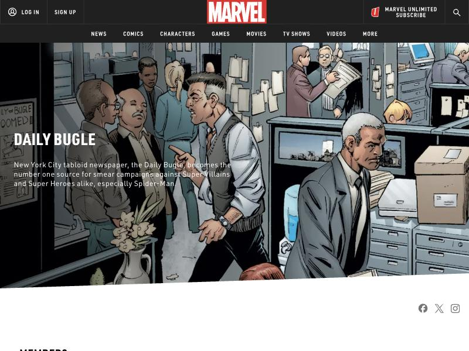

### O que observamos?
No universo do Homem-Aranha, o Daily Bugle é o tabloide de Nova York onde o Peter
Parker trabalha como fotógrafo. A página mostra a redação em quadrinhos, com
recortes presos nas paredes e jornais nas mãos dos personagens.

### O que vamos aproveitar?
A ideia de o Peter ser **fotógrafo de jornal**: é assim que ele ganha a vida e,
ao mesmo tempo, quem fotografa o Homem-Aranha.

### Como será adaptado?
A seção Queens à noite usa um jornal fictício, a **"Gazeta de Queens"** (com outro
nome, para não usar a marca), com manchete, foto em retícula e o crédito
"Foto: Peter Parker" em todas as capas.

## 8. Referência 07: Framer (CinematicCardDeck)

### Fonte
https://www.framer.com/marketplace/components/cinematiccarddeck/
Componente de Samba SYLLA no Framer.

### Imagem

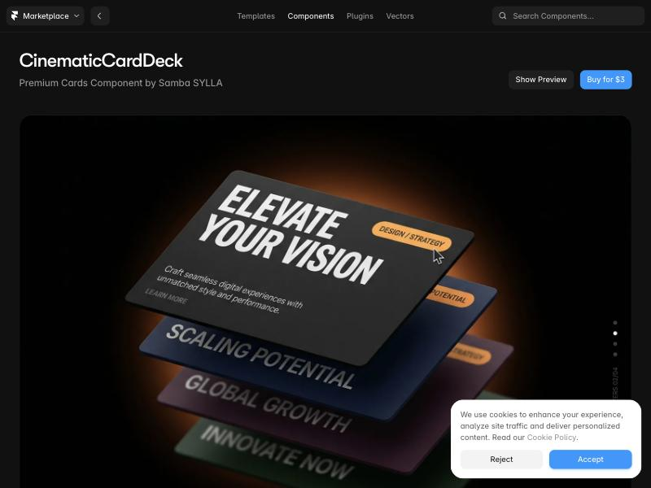

### O que observamos?
Cartões grandes empilhados em perspectiva sobre um fundo escuro, com um brilho
alaranjado atrás. O cartão da frente fica em destaque e os de trás aparecem
inclinados e mais escuros. O visual lembra a abertura de um filme: iluminação
dramática, tipografia pesada em caixa alta e muito contraste.

### O que vamos aproveitar?
O clima **cinematográfico** da pilha: fundo escuro, luz quente vindo de trás e
profundidade entre o cartão da frente e os demais.

### Como será adaptado?
Nas capas da Gazeta (`src/components/QueensSection.jsx`), a mesa escura com a
luz de luminária quente atrás da pilha, a capa da frente inclinando em 3D com o
mouse e as de trás escurecendo e recuando. A cena do mergulho nos Poderes
também usa a mesma ideia de luz dramática e vinheta escura.

## 9. Referência 08: Framer (CursorReveal)

### Fonte
https://www.framer.com/marketplace/components/cursorreveal/
Componente gratuito de Harshit Singh no Framer.

### Imagem

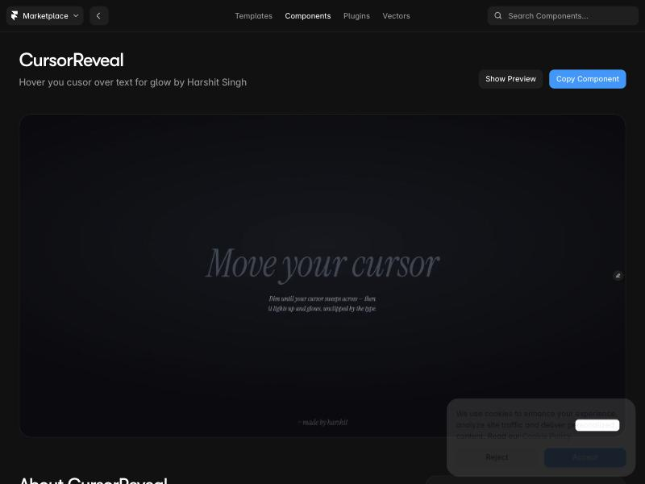

### O que observamos?
Um texto grande que fica apagado na tela escura e só acende quando o cursor passa
por cima: a luz segue o mouse e revela as letras por onde ele passou.

### O que vamos aproveitar?
Texto enorme que **só ganha cor onde o mouse passa**, em vez de ficar sempre
colorido.

### Como será adaptado?
No footer (`src/components/Footer.jsx`), o "PETER PARKER" gigante fica só em
contorno e se pinta de vermelho onde o mouse passa, com um degradê radial que
segue o cursor. O contorno é desenhado só por fora das letras (filtro SVG
`ftOutline`), porque a fonte tem formas sobrepostas que apareciam como traços
extras no contorno comum.

## 10. Referência 09: Framer (Selects)

### Fonte
https://www.framer.com/marketplace/templates/75078/
Template "Selects", de Jhan Torres Design
("Portfolio as a 35mm contact sheet").

### Imagem

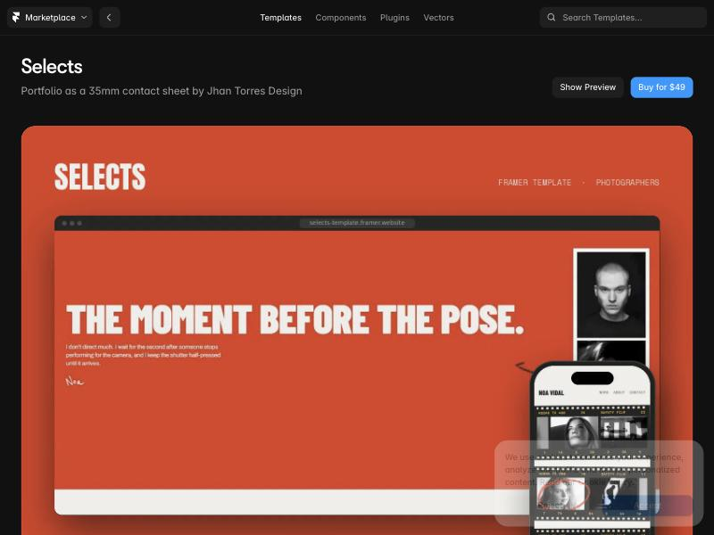

### O que observamos?
Um portfólio de fotografia que usa a **folha de contato de 35 mm** como interface:
tiras de filme com furos, numeração nas bordas e quadros em preto e branco, com
um círculo vermelho de lápis de cera marcando a foto escolhida (visível na versão
de celular). A tipografia é condensada e pesada, em caixa alta.

### O que vamos aproveitar?
A **folha de contato** como índice e o círculo vermelho de lápis de cera para
marcar o item escolhido.

### Como será adaptado?
No bloco da esquerda da seção Queens à noite (`src/components/QueensSection.jsx`),
o índice da semana virou duas tiras de filme com furos e numeração laranja nas bordas.
Cada quadro mostra o dia em preto e branco, o dia atual ganha cor e um círculo
vermelho desenhado à mão, e clicar leva à capa daquele dia. O texto ao lado usa
fita Dymo, tiras de papel datilografadas e fita crepe com marcador, o mesmo tipo
de material de um fotógrafo.

## 11. Observações

- As imagens do projeto (foto do Peter, máscara, cena do mergulho e logo da
  aranha) foram pegas no **Pinterest** e ajustadas com IA. Elas ficam em
  `public/assets/` e não são referências.
- Os demais componentes foram criados pelo autor, sem referência: o olho que abre,
  as folhas do caderno, o rádio-scanner, a vida dupla, o holofote com o sinal da
  aranha e o footer com o "PETER PARKER" gigante.
- Homem-Aranha, Peter Parker, Daily Bugle e personagens relacionados são
  propriedade da Marvel/Sony. Projeto acadêmico.
